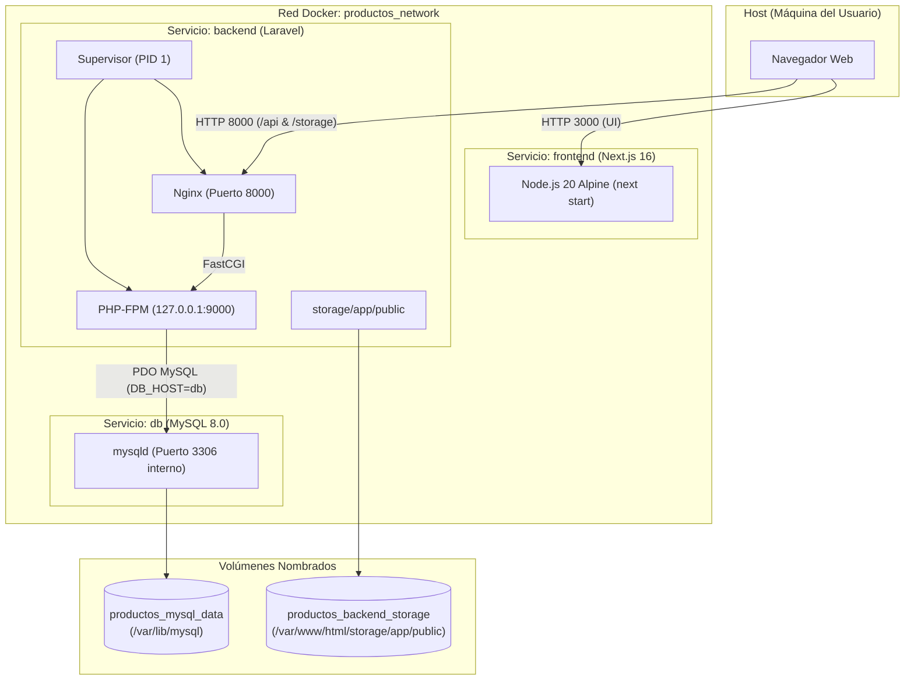

# Gestor de Productos — CRUD con Next.js, Laravel, MySQL y Docker

Este proyecto es una solución integral y evaluada para la gestión de productos (CRUD) estructurada con una arquitectura desacoplada y contenerizada mediante Docker Compose.

---

## 1. Propósito y Funcionalidades del Sistema

El sistema implementa la administración completa de un catálogo de productos con soporte para múltiples imágenes, categorías independientes y operaciones RESTful.

### Funcionalidades Implementadas:
- **Creación de Productos**: Registro de nombre, categoría (relación foránea), descripción y hasta 5 imágenes (formatos JPEG, PNG, WebP de hasta 5 MB por archivo) con generación de nombres hash seguros y almacenamiento atómico.
- **Listado Paginado**: Visualización en cuadrícula o tabla con miniatura, nombre, insignia de categoría y conteo de imágenes.
- **Búsqueda y Filtros**: Búsqueda en tiempo real por coincidencia parcial de nombre y filtrado por categoría seleccionada.
- **Detalle de Producto**: Vista dedicada con galería interactiva (imagen principal expandida y selector de miniaturas), especificaciones y metadatos de auditoría.
- **Edición Completa**: Formulario con datos precargados que permite modificar campos de texto, conservar las imágenes existentes, eliminar imágenes individuales y adjuntar nuevas imágenes hasta el límite global de 5.
- **Eliminación Segura con Confirmación**: Modal de confirmación para eliminar productos completos (limpiando físicamente todos sus archivos en disco) o eliminar imágenes individuales.
- **Manejo de Errores Reales**: Interfaz que captura y presenta los mensajes de error reales y las validaciones de campo (HTTP 422) devueltos por la API REST de Laravel.
- **Seeder de Demostración**: Permite poblar categorías de ejemplo (`CategorySeeder`) con una sola instrucción.

> [!NOTE]
> **Nota sobre el estado inicial del Workspace**:
> Tras la inspección inicial del directorio de trabajo (`c:\wamp64\www\productos`), se constató que se encontraba vacío (sin proyectos previos del bootcamp). En cumplimiento con la consigna académica, se desarrollaron desde cero tanto la aplicación frontend (Next.js 16 con App Router) como el backend API (Laravel 13 / PHP 8.3) y la configuración de MySQL 8.0 en Docker.

---

## 2. Arquitectura del Sistema

La arquitectura está diseñada para ejecutarse en exactamente **tres servicios** orquestados mediante `docker-compose.yml`:

1. `frontend`: Aplicación web moderna en Next.js ejecutada con `next start` en Node.js 20 Alpine.
2. `backend`: Servidor unificado de alto rendimiento donde Supervisor coordina tanto el servidor web **Nginx** (puerto 8000) como el procesador FastCGI **PHP-FPM** (127.0.0.1:9000 interno) dentro del mismo contenedor.
3. `db`: Base de datos relacional MySQL 8.0 con volumen persistente y puerto 3306 restringido a la red interna.

### Diagrama de Arquitectura de Contenedores



---

## 3. Versiones y Requisitos

| Componente | Versión Utilizada | Imagen Base de Docker | Justificación Técnica |
| :--- | :--- | :--- | :--- |
| **Node.js / Frontend** | 20.18 LTS / Next.js 16.4.5 | `node:20.18-alpine` | Recomendada expresamente por la consigna; garantiza estabilidad y soporte completo de App Router. |
| **PHP / Backend** | PHP 8.3.18 / Laravel 13.x | `php:8.3.18-fpm-alpine3.21` | Requisito real de `composer.lock` (`php: ^8.3`). Utiliza Alpine para minimizar la superficie de ataque y el tamaño de imagen. |
| **Servidor Web** | Nginx 1.26 | Incluido en runtime | Servidor web estándar para FastCGI, optimización de estáticos (`/storage/`) y encabezados HTTP. |
| **Supervisor** | supervisord (Python 3) | Incluido en runtime | Permite ejecutar Nginx y PHP-FPM en un único contenedor manteniendo supervisión de procesos y propagación de señales UNIX. |
| **Base de Datos** | MySQL 8.0.41 | `mysql:8.0.41` | Versión oficial LTS de MySQL con soporte UTF-8mb4 completo. |
| **Docker Engine** | 24.0 o superior | — | Soporte para BuildKit y Docker Compose v2. |

---

## 4. Estructura del Proyecto

```text
productos/
├── .env.example                   # Plantilla documentada de variables del ecosistema
├── .gitignore                     # Reglas de exclusión de secretos y temporales
├── docker-compose.yml             # Orquestación de los 3 servicios
├── README.md                      # Documentación integral del proyecto
│
├── database/                      # Servicio MySQL
│   ├── Dockerfile                 # Dockerfile de la base de datos
│   └── .dockerignore              # Exclusiones de construcción para db
│
├── backend/                       # Servicio Laravel API REST
│   ├── Dockerfile                 # Multi-stage Dockerfile (vendor + runner)
│   ├── .dockerignore              # Exclusiones de construcción backend
│   ├── .env.example               # Configuración local de Laravel
│   ├── composer.json              # Dependencias PHP
│   ├── composer.lock              # Bloqueo exacto de dependencias PHP
│   ├── artisan                    # CLI de Laravel
│   ├── app/
│   │   ├── Http/
│   │   │   ├── Controllers/       # ProductController, CategoryController, ProductImageController
│   │   │   ├── Requests/          # StoreProductRequest, UpdateProductRequest
│   │   │   └── Resources/         # ProductResource, CategoryResource, ProductImageResource
│   │   └── Models/                # Product, Category, ProductImage
│   ├── config/                    # Configuración de cors, filesystems, database, etc.
│   ├── database/
│   │   ├── migrations/            # Migraciones (categories, products, product_images)
│   │   └── seeders/               # CategorySeeder, DatabaseSeeder
│   ├── docker/
│   │   ├── entrypoint.sh          # Script de arranque (permisos, link, migraciones, cachés)
│   │   ├── nginx.conf             # Configuración del servidor Nginx (puerto 8000, 30MB upload)
│   │   ├── php.ini                # Ajustes de PHP (upload_max_filesize=30M, post_max_size=35M)
│   │   └── supervisord.conf       # Supervisión de PHP-FPM y Nginx
│   ├── routes/
│   │   └── api.php                # Definición de rutas RESTful
│   └── tests/
│       └── Feature/
│           └── ProductCrudTest.php # Suite de pruebas de integración para el CRUD
│
└── frontend/                      # Servicio Next.js 16
    ├── Dockerfile                 # Multi-stage Dockerfile (deps, builder, runner)
    ├── .dockerignore              # Exclusiones de construcción frontend
    ├── .env.example               # Configuración de variables del cliente
    ├── package.json               # Dependencias de Node.js
    ├── package-lock.json          # Bloqueo reproducible de dependencias npm
    ├── next.config.ts             # Configuración de Next.js (patrones de imágenes remotas)
    ├── tsconfig.json              # Configuración de TypeScript
    ├── app/
    │   ├── globals.css            # Estilos globales y Tailwind CSS
    │   ├── layout.tsx             # Layout raíz con Navbar y Footer
    │   ├── page.tsx               # Vista: Listado, búsqueda, filtrado y paginación
    │   └── products/
    │       ├── create/page.tsx    # Vista: Creación de producto y previsualización de fotos
    │       └── [id]/
    │           ├── page.tsx       # Vista: Detalle de producto y galería de imágenes
    │           └── edit/page.tsx  # Vista: Edición de producto y gestión de imágenes
    ├── components/
    │   ├── DeleteModal.tsx        # Modal accesible de confirmación de borrado
    │   ├── ImageGallery.tsx       # Galería de imágenes (principal y miniaturas)
    │   ├── ImageUploader.tsx      # Carga múltiple, validación y previsualización
    │   ├── Navbar.tsx             # Barra de navegación superior
    │   └── StatusMessage.tsx      # Banners de alerta con detalle de errores 422
    ├── lib/
    │   ├── api.ts                 # Cliente HTTP fetch y manejo de errores de Laravel
    │   └── types.ts               # Tipado estricto TypeScript
    └── public/
        └── placeholder-image.svg  # Imagen vectorial para productos sin fotografía
```

---

## 5. Preparación Inicial del Entorno y Variables

Antes del primer levantamiento con Docker, crea el archivo `.env` en la raíz copiando la plantilla:

```bash
# En Windows PowerShell o Bash:
cp .env.example .env
```

### Generación de `APP_KEY` de Laravel

La clave de cifrado `APP_KEY` debe generarse **una sola vez** y mantenerse externamente en el archivo `.env`. No debe generarse durante la construcción de la imagen Docker ni cambiar en cada reinicio.

Para generar una clave válida, ejecuta:

```bash
# Opción A (si tienes PHP instalado en el host):
php backend/artisan key:generate --show

# Opción B (utilizando una imagen efímera de PHP mediante Docker):
docker run --rm php:8.3-cli-alpine php -r "echo 'base64:' . base64_encode(random_bytes(32)) . PHP_EOL;"
```

Copia la clave resultante y asígnala a la variable `APP_KEY` en tu `.env`:

```env
APP_KEY=base64:Xxxxxxxxxxxxxxxxxxxxxxxxxxxxxxxxxxxxxxxxxxxx=
```

### Variables de Configuración en `.env`

```env
# Backend Laravel
APP_NAME="Gestor de Productos"
APP_ENV=production
APP_KEY=base64:tu_clave_generada_aqui
APP_DEBUG=false
APP_URL=http://localhost:8000
FRONTEND_URL=http://localhost:3000
AUTO_MIGRATE=true

# Base de Datos MySQL
MYSQL_ROOT_PASSWORD=secret_root_password
DB_DATABASE=productos_db
DB_USERNAME=productos_user
DB_PASSWORD=secret_user_password

# Frontend Next.js (Variables públicas embebidas durante build/runtime)
NEXT_PUBLIC_API_URL=http://localhost:8000/api
NEXT_PUBLIC_STORAGE_URL=http://localhost:8000/storage
```

---

## 6. Despliegue y Gestión con Docker Compose

### 1. Construir y Levantar el Ecosistema Completo

Ejecuta el siguiente comando en la raíz del proyecto:

```bash
docker compose up --build -d
```

Este comando:
- Construye las tres imágenes Docker aplicando caché de capas.
- Inicia el contenedor `db` y espera a que su healthcheck reporte estado `healthy`.
- Inicia el contenedor `backend`, ejecuta las verificaciones del `entrypoint.sh` (creación de symlink de almacenamiento y migraciones no destructivas) y levanta Nginx + PHP-FPM bajo Supervisor.
- Inicia el contenedor `frontend`, arrancando el servidor Next.js en el puerto 3000.

### 2. Consultar el Estado y los Registros (Logs)

```bash
# Ver estado de los 3 contenedores y sus healthchecks:
docker compose ps

# Ver logs en tiempo real de todos los servicios:
docker compose logs -f

# Ver logs específicos del backend (Nginx y PHP-FPM):
docker compose logs backend -f

# Ver logs del frontend (Next.js):
docker compose logs frontend -f
```

### 3. Detener los Contenedores

```bash
# Detiene y remueve los contenedores CONSERVANDO todos los datos y volúmenes:
docker compose down
```

> [!CAUTION]
> **Persistencia de Datos**: El comando `docker compose down` detiene los contenedores pero **mantiene intactos** los volúmenes nombrados de la base de datos y de las imágenes. **NO** utilices el modificador `-v` (`docker compose down -v`) a menos que desees eliminar irreversiblemente todos los productos, categorías y archivos multimedia almacenados.

---

## 7. Migraciones y Datos de Ejemplo (Seeder)

El contenedor `backend` tiene configurado `AUTO_MIGRATE=true` en su entrypoint, lo que ejecuta de forma controlada y no destructiva:
```bash
php artisan migrate --force
```
*(Nota: Jamás se ejecuta `migrate:fresh`, preservando los datos existentes en cualquier reinicio).*

### Carga del Seeder de Categorías

Para poblar las categorías de muestra iniciales (ej. Electrónica, Ropa, Hogar, etc.), ejecuta el seeder opcional mediante:

```bash
docker compose exec backend php artisan db:seed --class=CategorySeeder
```

Si deseas verificar el estado de las migraciones:

```bash
docker compose exec backend php artisan migrate:status
```

---

## 8. Acceso y Consumo de las Aplicaciones

Una vez iniciados los servicios, accede desde el navegador web de tu máquina anfitriona:

- **Frontend (Next.js)**: [http://localhost:3000](http://localhost:3000)
- **API REST (Laravel)**: [http://localhost:8000/api](http://localhost:8000/api)
- **Archivos Estáticos / Imágenes**: [http://localhost:8000/storage/](http://localhost:8000/storage/)
- **Healthcheck del Backend**: [http://localhost:8000/up](http://localhost:8000/up)

### Resumen de Endpoints de la API REST

| Método | Endpoint | Descripción | Parámetros / Body |
| :--- | :--- | :--- | :--- |
| `GET` | `/api/categories` | Listado de categorías ordenadas con conteo de productos | — |
| `POST` | `/api/categories` | Crear una nueva categoría | `{ "name": "string" }` |
| `GET` | `/api/products` | Listado paginado con búsqueda y filtros | `?search=texto&category_id=1&page=1&per_page=8` |
| `POST` | `/api/products` | Crear producto con imágenes | `multipart/form-data`: `name`, `category_id`, `description`, `images[]` |
| `GET` | `/api/products/{id}` | Consultar detalle de un producto y su galería | — |
| `PUT` / `POST` | `/api/products/{id}` | Actualizar datos y adjuntar nuevas imágenes | `multipart/form-data` con `_method=PUT` |
| `DELETE` | `/api/products/{id}` | Eliminar producto y sus archivos en disco | — |
| `DELETE` | `/api/products/{id}/images/{imgId}` | Eliminar una imagen individual del producto | — |
| `DELETE` | `/api/product-images/{id}` | Eliminar una imagen individual por su ID directo | — |

---

## 9. Decisiones Técnicas en los Dockerfiles

### Frontend (`frontend/Dockerfile`)
1. **Multi-stage**:
   - `deps`: Instala dependencias con `npm ci` a partir de `package.json` y `package-lock.json`, beneficiándose de la caché de Docker ante cambios de código.
   - `builder`: Recibe los argumentos `NEXT_PUBLIC_*`, compila el proyecto mediante `next build` y poda las dependencias de desarrollo con `npm prune --production`.
   - `runner`: Imagen Alpine limpia basada en `node:20.18-alpine`. Copia únicamente los artefactos requeridos (`.next` sin la carpeta de caché `.next/cache`, `node_modules` de producción y `public`).
2. **Ejecución con `next start`**: Cumple rigurosamente el requisito de iniciar el servidor Node mediante `./node_modules/.bin/next start -p 3000 -H 0.0.0.0` en lugar de recurrir al modo `standalone`.
3. **Seguridad**: Ejecuta bajo el usuario no privilegiado `node` (UID 1000).

### Backend (`backend/Dockerfile`)
1. **Multi-stage**:
   - `vendor`: Contenedor efímero con Composer 2.8 para resolver e instalar dependencias con `--no-dev --optimize-autoloader`.
   - `runner`: Basado en `php:8.3.18-fpm-alpine3.21`.
2. **Extensiones de PHP**:
   - *Nativas en PHP 8.3 CLI/FPM*: `mbstring`, `openssl`, `tokenizer`, `ctype`, `json`.
   - *Instaladas explícitamente*: `pdo_mysql`, `xml`, `bcmath`, `opcache`.
3. **Supervisión de Procesos**:
   - Implementa `supervisord` como PID 1 para coordinar **Nginx** y **PHP-FPM** en el mismo contenedor.
   - Nginx atiende peticiones en el puerto 8000 y se comunica vía FastCGI localmente con PHP-FPM en `127.0.0.1:9000`.
   - Los logs de acceso y error de ambos procesos se canalizan directamente a `/dev/stdout` y `/dev/stderr`.
4. **Límites de Carga**:
   - Nginx: `client_max_body_size 30M;`
   - PHP: `upload_max_filesize = 30M`, `post_max_size = 35M`, permitiendo hasta 5 archivos de 5 MB por petición.
5. **Permisos**:
   - Directorios `storage/` y `bootstrap/cache/` asignados al usuario de ejecución `www-data:www-data` con permisos `775` (sin emplear `chmod 777`).

### Base de Datos (`database/Dockerfile`)
- Basado en `mysql:8.0.41`.
- Configura el juego de caracteres a `utf8mb4` con collation `utf8mb4_unicode_ci`.
- **No requiere etapa de compilación**: La imagen oficial de MySQL provee los binarios compilados y la lógica de inicialización en `/docker-entrypoint-initdb.d/`.
- El puerto 3306 se expone únicamente dentro de la red interna de Docker (`expose: - "3306"`), sin publicarlo al host anfitrión para proteger el acceso a la base de datos.

---

## 10. Persistencia y Conectividad

- **Base de Datos**: Se almacena en el volumen nombrado `productos_mysql_data`, montado en `/var/lib/mysql`.
- **Imágenes Cargadas**: Se almacenan en el volumen nombrado `productos_backend_storage`, montado en `/var/www/html/storage/app/public`.
- **Enlace Simbólico**: El `entrypoint.sh` asegura la creación del enlace simbólico `public/storage -> storage/app/public` al iniciar el contenedor. Nginx cuenta con una regla `location /storage/` optimizada para servir las imágenes directamente con encabezados de caché `public, max-age=30d`.
- **Diferenciación de URLs**:
  - *Interna de Docker*: El backend se comunica con MySQL a través del hostname `db` (`DB_HOST=db`).
  - *Externa del Navegador*: El navegador cliente del usuario consume la API en `http://localhost:8000/api` y las imágenes en `http://localhost:8000/storage/...`.

---

## 11. Solución de Problemas Frecuentes (Troubleshooting)

### 1. El backend reporta `SQLSTATE[HY000] [2002] Connection refused`
- **Causa**: MySQL aún no ha finalizado su inicialización interna.
- **Solución**: El servicio `backend` cuenta con `depends_on` condicionado a `service_healthy` de `db`. Si persiste, comprueba los registros de MySQL con `docker compose logs db`.

### 2. Error al cargar imágenes: `413 Request Entity Too Large`
- **Causa**: El archivo supera los límites establecidos.
- **Solución**: El sistema está configurado para un límite global de 30 MB en Nginx y 5 MB por archivo individual. Verifica que cada imagen no sobrepase los 5 MB ni exceda los 5 archivos en total.

### 3. Conflicto de puertos en el Host (3000 o 8000 en uso)
- **Causa**: Tienes otra aplicación local (como WAMP, Apache o un servidor Node local) escuchando en dichos puertos.
- **Solución**: Detén el servicio local en conflicto o modifica el mapeo de puertos en `docker-compose.yml` (por ejemplo, `"8080:8000"` para el backend).

---

## 12. Publicación en un Repositorio GitHub

Para publicar este proyecto en un nuevo repositorio de GitHub:

```bash
# 1. Asegúrate de estar en la raíz del proyecto
cd c:\wamp64\www\productos

# 2. Verifica que los archivos sensibles (.env, vendor, node_modules) estén excluidos
git status

# 3. Agrega todos los archivos versionables al índice
git add .

# 4. Crea el commit inicial
git commit -m "feat: CRUD de productos con Next.js 16, Laravel 13, MySQL y Docker"

# 5. Define la rama principal como main
git branch -M main

# 6. Vincula tu repositorio remoto (reemplaza <USUARIO> y <REPOSITORIO>)
git remote add origin https://github.com/<TU_USUARIO>/<TU_REPOSITORIO>.git

# 7. Sube los cambios a GitHub
git push -u origin main
```

> [!NOTE]
> El archivo `.gitignore` configurado en la raíz y subproyectos previene que credenciales reales, claves de cifrado o archivos binarios pesados sean incluidos en el repositorio público.
